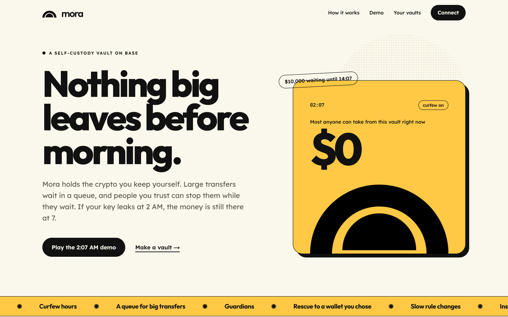
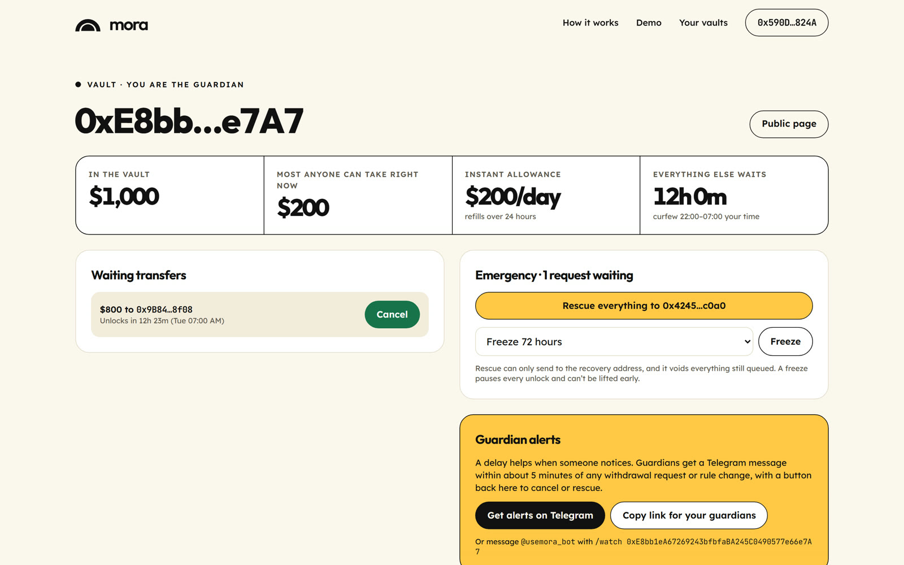
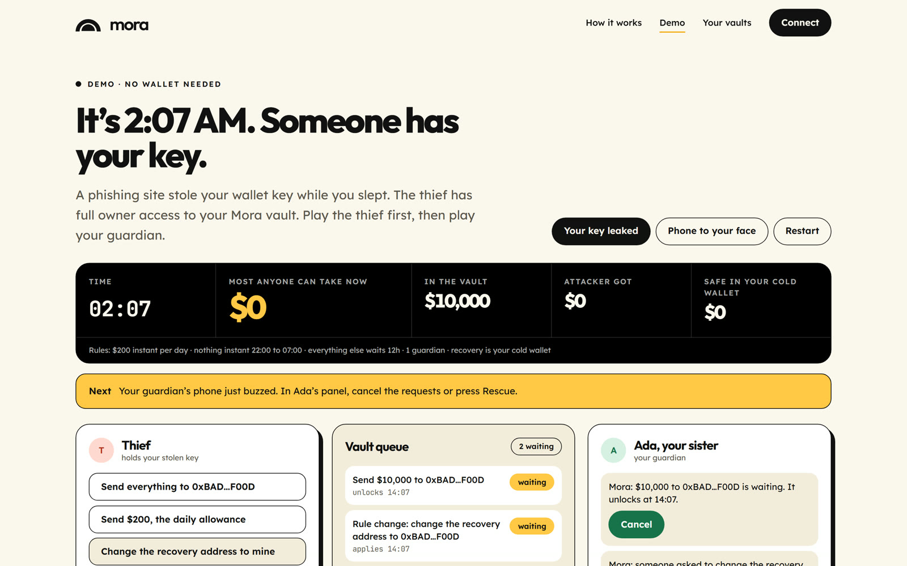
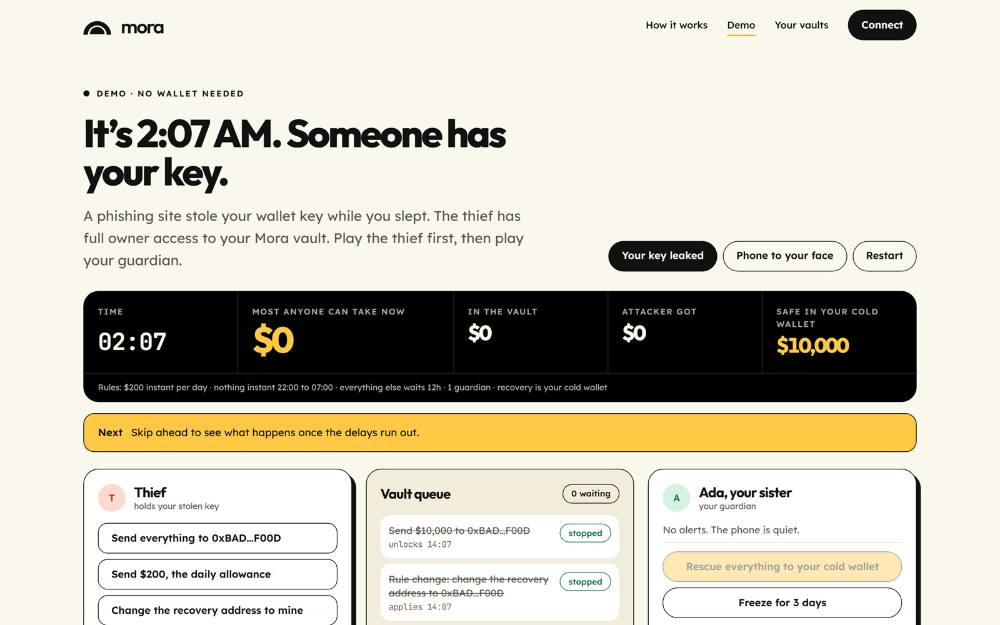
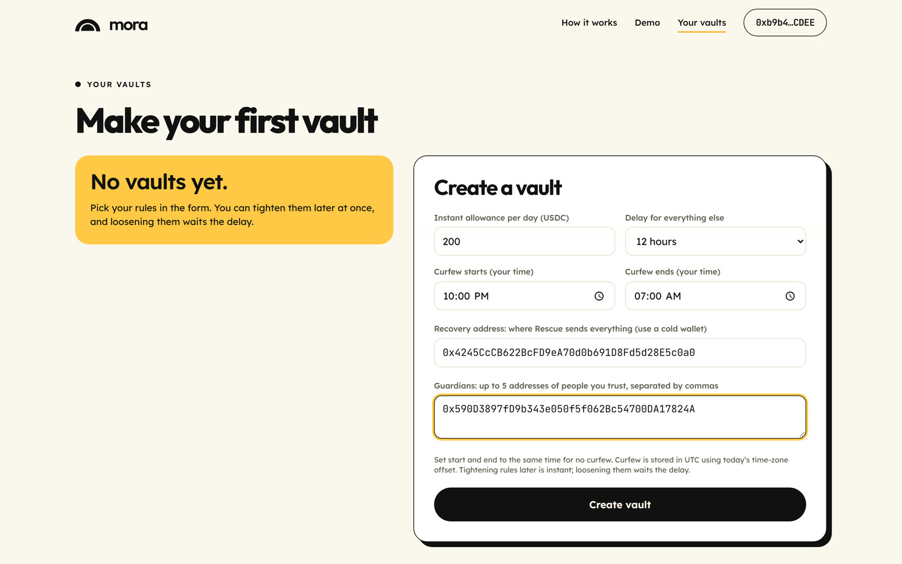
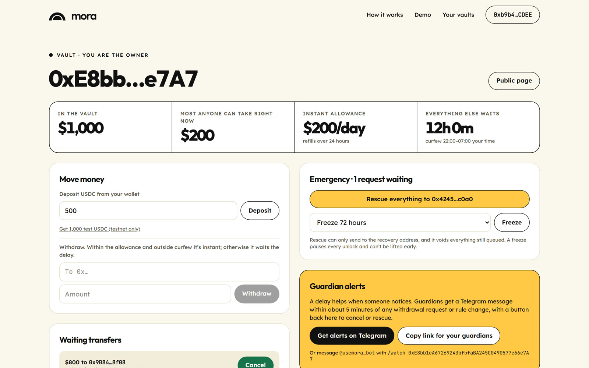
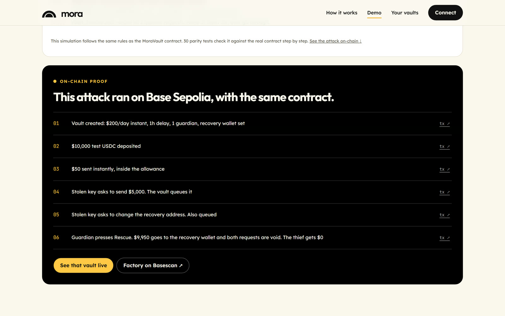
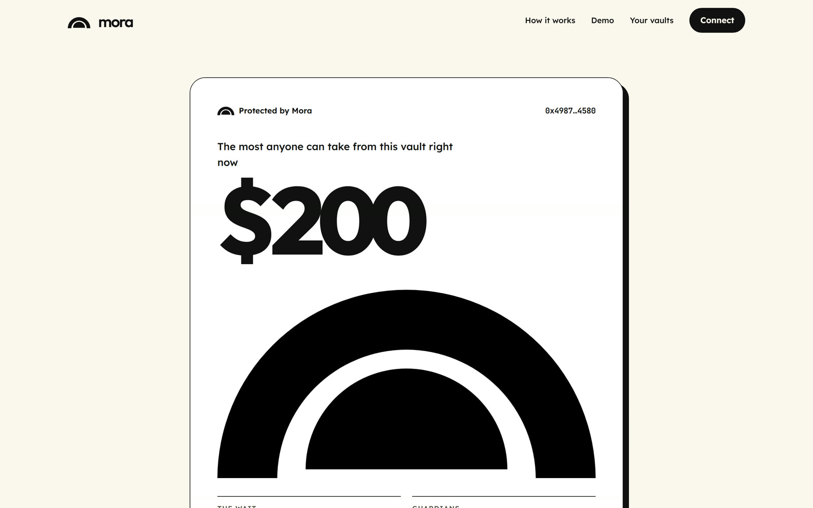
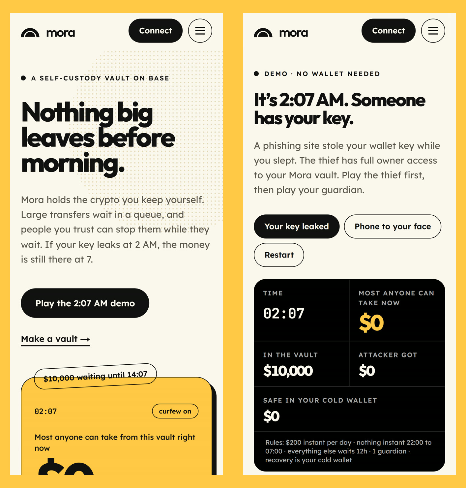

# Mora

**A time-delay safe for your crypto, on Base.**

Small amounts leave your vault right away. Anything bigger waits in a queue, and people you trust get a Telegram alert while it waits. If your key leaks at 2 AM, they can stop the transfer or send everything to a cold wallet you chose in advance.

*Mora* is Latin for **delay**.

**[Open the app](https://trymora.xyz)** · **[Play the 2:07 AM demo](https://trymora.xyz/demo)** (no wallet needed) · **[Watch the film](docs/mora-film.mp4)** · **[Alerts bot: @usemora_bot](https://t.me/usemora_bot)**

Built for **Vibestarter Vibeathon 02** (theme: *Night shift*). Runs on Base Sepolia testnet.



---

## Contents

1. [The problem](#the-problem)
2. [How Mora works](#how-mora-works)
3. [What happens in an attack](#what-happens-in-an-attack)
4. [Try it](#try-it)
5. [Screens](#screens)
6. [Live on Base Sepolia](#live-on-base-sepolia)
7. [How it is built](#how-it-is-built)
8. [Run it yourself](#run-it-yourself)
9. [Limits](#limits)
10. [Roadmap](#roadmap)

---

## The problem

- **Stolen keys.** In 2025, Chainalysis counted about 158,000 personal wallet compromises, with at least 80,000 victims and about $713M taken. With a normal wallet, one signed transaction empties it in about two seconds.
- **Physical threats.** CertiK counted 72 verified "wrench attacks" in 2025, where someone is forced in person to hand over crypto. In the first half of 2026 there were 52 more, and reported home invasions rose from 1 to 20.
- **Delays exist only at exchanges.** In 2026, Binance, SwissBorg and Coinbase added withdrawal delays and trusted contacts for the money they hold. People who keep their own keys on Base have had nothing like it with a simple app.

## How Mora works

You put funds in a Mora vault and set its rules once. The vault holds the funds itself and follows those rules every time.

| Rule | What it does |
|---|---|
| **Instant allowance** | Small amounts, $200 a day for example, leave right away. The allowance refills a little at a time over 24 hours, so two withdrawals timed around midnight can't double it. |
| **Curfew hours** | During the hours you sleep, 22:00 to 07:00 for example, the instant allowance is $0. |
| **Everything else waits** | A bigger withdrawal goes into a queue for the full delay you set, 12 hours for example. If the wait would end during curfew, it moves to the end of curfew. |
| **Guardians** | Up to 5 people you trust. Each one can **cancel** a queued request, **freeze** the vault for up to 3 days, or **rescue**. A guardian can never withdraw. |
| **Rescue** | Sends the whole balance to the **recovery address you set in advance**, and nowhere else. It also cancels everything still in the queue, so a thief can't leave a change of owner or recovery address waiting behind it. |
| **Loosening waits too** | Raising a limit, removing a guardian, or changing the recovery address or owner also goes through the queue and can be cancelled. Making rules stricter takes effect at once. |
| **Public check** | Each vault has a public page, `/v/<address>`, that reads `maxExtractableNow()` from the contract: the most anyone can take right now. At night that is usually $0. |
| **Telegram alerts** | One public bot, [@usemora_bot](https://t.me/usemora_bot). Anyone can watch a vault with one tap. Watchers get a message within about 5 minutes of any withdrawal request or rule change, with a link to the vault page where they can cancel or rescue. See [alerts/README.md](alerts/README.md). |



## What happens in an attack

| Situation | Result |
|---|---|
| Your key is stolen and used at 2:07 AM | Every transfer goes into the queue. A guardian presses Rescue, the money goes to your recovery wallet, and the thief's queued requests are cancelled. **The thief gets $0.** |
| Your key is stolen and used during the day | The most that leaves is what remains of the day's allowance. Everything else can be cancelled or rescued. |
| Someone forces you at home to send everything and loosen the rules | The transfer and the rule changes all wait in the queue, and a guardian cancels them. |
| A guardian turns against you | They can freeze the vault or rescue the funds to *your* recovery address. They can't take anything. |
| The thief adds themselves as a guardian | Rescue still sends only to your recovery address, so they gain nothing. |

## Try it

1. **Play the demo.** Open [trymora.xyz/demo](https://trymora.xyz/demo). It is 2:07 AM and a thief has your key. Try to send everything and change the recovery address, then switch to the guardian and press Rescue. The second scenario, "Phone to your face", plays out a threat in person. No wallet needed.
2. **Check the real run.** Scroll down on the demo page. The same attack ran on Base Sepolia, and every step links to its transaction.
3. **See a public page.** Open [the attacked vault's public page](https://trymora.xyz/v/0x49879021E8C90B25514F3ba03F15a82eb7C44580) to see what anyone can take from it right now.
4. **Make your own vault.** Go to [trymora.xyz/app](https://trymora.xyz/app) and connect a Base Account passkey or any browser wallet on Base Sepolia. Fill in the form, press **Get 1,000 test USDC**, deposit, and try a small and a large withdrawal.
5. **Turn on alerts.** On the vault page, tap **Get Telegram alerts**, or send the guardian link to the people you trust.

## Screens

| | |
|---|---|
|  |  |
| The demo: the thief's requests sit in the queue | After Rescue: the attacker got $0 |
|  |  |
| Creating a vault | The owner's dashboard with a queued withdrawal |
|  |  |
| Each step of the real attack, linked to Basescan | The public page: the most anyone can take right now |



## Live on Base Sepolia

| Contract | Address |
|---|---|
| `MoraFactory` | [0x967cd50D421d497EF2D1753635bDC30F3Acd514B](https://sepolia.basescan.org/address/0x967cd50D421d497EF2D1753635bDC30F3Acd514B) |
| `MoraVault` (implementation) | [0x9602447cAaC26C34E9ee0B41a6316032268724ED](https://sepolia.basescan.org/address/0x9602447cAaC26C34E9ee0B41a6316032268724ED) |
| `MockUSDC` (test token, anyone can mint) | [0x15675CcFBa9E7Ca64fFe64cDD4D8DBc75e219636](https://sepolia.basescan.org/address/0x15675CcFBa9E7Ca64fFe64cDD4D8DBc75e219636) |

The source code is verified with an exact match on Sourcify. You can read it on Blockscout:
[MoraFactory](https://base-sepolia.blockscout.com/address/0x967cd50D421d497EF2D1753635bDC30F3Acd514B?tab=contract) ·
[MoraVault](https://base-sepolia.blockscout.com/address/0x9602447cAaC26C34E9ee0B41a6316032268724ED?tab=contract) ·
[MockUSDC](https://base-sepolia.blockscout.com/address/0x15675CcFBa9E7Ca64fFe64cDD4D8DBc75e219636?tab=contract)
(or on [Sourcify](https://repo.sourcify.dev/84532/0x967cd50D421d497EF2D1753635bDC30F3Acd514B)). Every vault is a small copy (an EIP-1167 clone) of that one `MoraVault`.

### The stolen-key attack, run for real

Against vault [0x4987…4580](https://sepolia.basescan.org/address/0x49879021E8C90B25514F3ba03F15a82eb7C44580):

1. [The vault is created](https://sepolia.basescan.org/tx/0x9c8ad6a2380b0b7295e10a25948369a1d46553d37e6cef917c4161e04eddd2b8) with a $200 daily allowance, a 1 hour delay, 1 guardian and a recovery wallet.
2. [$10,000 in test USDC is deposited](https://sepolia.basescan.org/tx/0x3ec5fc2ddf6bf2b89dd1e741b559e14ec00bd6d751c0dae99cc2d9f78ed38419).
3. [$50 leaves at once](https://sepolia.basescan.org/tx/0xa5c67f7cec592ee31afa03128afc7ae0e20f7fff22a92d6434b774a1b3f1fd66), inside the allowance.
4. The stolen key tries to [send $5,000](https://sepolia.basescan.org/tx/0x8db72ec54dc11ba872520a22e0127b3e44dc64397418ed878f4618e8309c254d) and [change the recovery address](https://sepolia.basescan.org/tx/0xcab1125591bdee4f063246586838b53a66f76563a5b334a5fd6039213ad9e047). Both go into the queue.
5. [The guardian presses Rescue](https://sepolia.basescan.org/tx/0xbeea5b9b4c6ca60d6e1e19d36ee658a60ae430a846de2140b128bb81bd5f4dfe). $9,950 goes to the recovery wallet and both requests are cancelled. Trying to run them afterwards fails with `NotPending`. **The thief got $0.**

The web app was also tested end to end on the live site with fresh wallets: create a vault, mint, deposit, an instant withdrawal, a queued withdrawal, then a guardian's cancel, freeze and rescue. The balances on chain matched each step.

## How it is built

### The contract is small on purpose

`MoraVault` is a standalone contract that holds the funds itself. It is not a module added to a wallet, so a wallet's other owners or modules have no way around the delay. Tokens leave in only three ways: an instant withdrawal within the allowance, a queued withdrawal after its delay, or a rescue to the recovery address.

The contract has **no** arbitrary call function, **no** `approve`, **no** `delegatecall`, **no** upgrade path and **no** native ETH. `MoraFactory` deploys one clone per user, and every clone points at the same fixed implementation for good.

### What is in this repo

```
contracts/      MoraVault, MoraFactory and MockUSDC (Solidity 0.8.28)
test/           35 contract tests and 30 parity tests
scripts/        deploy.js and export-abi.js
web/            Next.js app: landing page, demo, vault dashboard, public page
alerts/         Telegram alert worker that runs on GitHub Actions
docs/           screenshots and the demo film
.github/        the alerts workflow, every 5 minutes
```

### Tests

- **35 contract tests** cover setup, the allowance (including attempts to split a transfer or time it around the refill), curfew across midnight, minimum delays, cancel, freeze, rescue (including clearing the queue), delayed rule changes and the full attack scenarios above.
- **30 parity tests** (`test/Parity.test.js`) keep the no-wallet demo honest. They drive the demo's simulator (`web/src/lib/sim.ts`) and the real contract through the same random sequences of withdrawals, cancels, freezes, rescues, rule changes and time jumps. After every step they check that balances, queue states, unlock times and `maxExtractableNow` all match.

### The web app

Next.js 16 with React 19, Tailwind CSS 4, wagmi and viem. You can connect with a Base Account passkey or any browser wallet. See [web/README.md](web/README.md) for the pages and setup.

### Alerts

A GitHub Actions job runs every 5 minutes, reads new vault events from Base Sepolia, and messages everyone watching that vault on Telegram. The list of who watches what is stored encrypted on the repo's `alerts-state` branch. No server is needed. See [alerts/README.md](alerts/README.md).

## Run it yourself

### Contracts

```bash
npm install
npx hardhat test
```

The project compiles with the `solc` 0.8.28 that npm installs (solc-js), so no compiler download is needed.

### Deploy to Base Sepolia

Use a throwaway test wallet funded from a Base Sepolia faucet:

```bash
DEPLOYER_KEY=0x... npx hardhat run scripts/deploy.js --network baseSepolia
```

On Windows PowerShell, this reads the key without saving it in your shell history:

```powershell
$env:DEPLOYER_KEY = Read-Host "Deployer key"; npx hardhat run scripts/deploy.js --network baseSepolia; Remove-Item Env:DEPLOYER_KEY
```

This deploys a test USDC (`MockUSDC`) and the factory. Set `USDC_ADDRESS` to use an existing token instead.

### Web app

```bash
cd web
cp .env.example .env.local   # paste in the addresses the deploy script printed
npm install
npm run dev
```

## Limits

- **Unaudited.** Use it on testnet only for now.
- **It protects only what is inside the vault.** Your everyday wallet works as before.
- **A delay gives people time to act.** It can't stop someone who holds you for longer than the delay. That is why guardians, freeze and rescue exist.
- **Curfew hours are stored in UTC.** The app converts them to your local time.
- **Guardians should be people who will answer.** A guardian can cause trouble by freezing or by rescuing to your own recovery address, but can't take funds.
- **A leaked key means starting a new vault.** You and the thief hold the same owner key, so the contract can't tell you apart. The thief can cancel your proposed changes, just as you can cancel theirs. Rescue moves the money to your recovery wallet. After that, create a fresh vault with a new key.
- **Someone has to be watching.** If no guardian notices a queued request before it unlocks, it goes through. Alerts help, and more than one guardian helps more. GitHub's scheduler is usually on time but can run 10 to 15 minutes late, so set a delay well above that.

## Roadmap

- Cancel straight from the Telegram alert. Today the alert's button opens the vault page, where the guardian taps Cancel.
- Founder vaults for teams that receive Vibestarter tranches.
- An agent wallet mode: an AI agent spends small amounts at once, and anything large waits for your approval in the morning.

## Prior art

Argent's daily limits and guardians, Safe's Zodiac Delay module and the 2026 exchange withdrawal locks all shaped this design. Mora adds rescue to an address set in advance, curfew hours, a delay on every loosening of the rules, and a public check of what can leave right now, all in a standalone vault on Base.

## License

MIT
