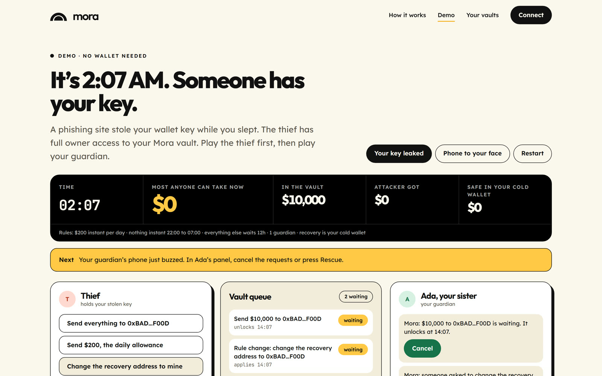

# Mora web app

The Next.js app behind [trymora.xyz](https://trymora.xyz). It runs on Base Sepolia.



## Pages

| Route | What it shows |
|---|---|
| `/` | The landing page |
| `/demo` | The "2:07 AM" demo, with no wallet needed. Two scenarios, a stolen key and a threat in person, run on an in-browser copy of the vault rules (`src/lib/sim.ts`). Below them is the list of the same attack run on chain, with a link to each transaction. |
| `/app` | Connect with a Base Account passkey or a browser wallet, see your vaults and create a new one |
| `/vault/[address]` | The vault dashboard: deposit, withdraw, see waiting transfers with countdowns, cancel or send them, freeze, rescue, change settings, and turn on Telegram alerts. It shows owner or guardian controls depending on the wallet you connect. |
| `/v/[address]` | The public page: the most anyone can take from the vault right now, read live from the contract |

The layout works on phones, tablets and desktops.

## Stack

Next.js 16, React 19, Tailwind CSS 4, wagmi and viem. Fonts are Outfit, Lexend and JetBrains Mono.

| Folder | What is in it |
|---|---|
| `src/app/` | One folder per page, plus `globals.css` with the colours and shared styles |
| `src/components/` | Header, footer, logo, connect button, alerts card and transaction status |
| `src/lib/` | Contract ABIs, config, the demo simulator, the on-chain proof steps, hooks and the wagmi setup |

## Run it locally

```bash
cp .env.example .env.local   # paste in the addresses the deploy script printed
npm install
npm run dev
```

Then open http://localhost:3000. Without contract addresses, the landing page and `/demo` still work, and the wallet pages show a "contracts not connected" notice.

### Settings

| Variable | What it is for |
|---|---|
| `NEXT_PUBLIC_FACTORY_ADDRESS` | The `MoraFactory` address |
| `NEXT_PUBLIC_USDC_ADDRESS` | The token the vaults hold |
| `NEXT_PUBLIC_USDC_IS_MOCK` | `true` shows the "Get 1,000 test USDC" button. Set it to `false` for real USDC. |
| `NEXT_PUBLIC_RPC_URL` | Optional. Your own Base Sepolia RPC. The public one is used by default. |
| `NEXT_PUBLIC_ALERT_BOT` | The Telegram bot's username, without `@`. Defaults to `usemora_bot`. Leave it empty to hide the alert links. |

## Deploy to Vercel

Import the repo, set **Root Directory** to `web`, and add the settings above as environment variables.

## Contract ABIs

`src/lib/abi.ts` is generated. After you change a contract, run `npm run abi` in the repo root.
